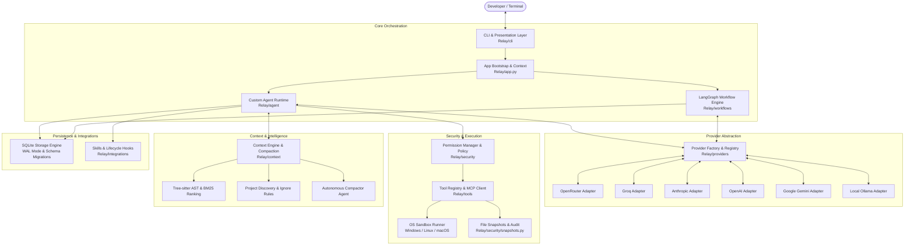
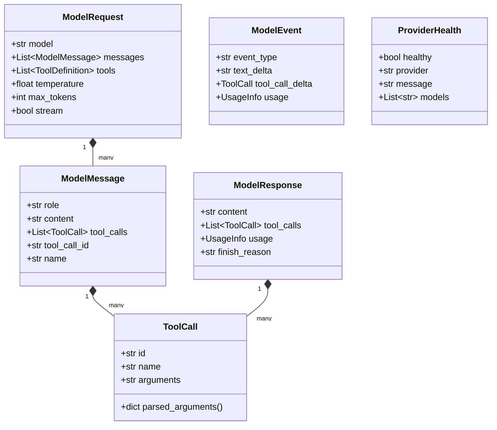
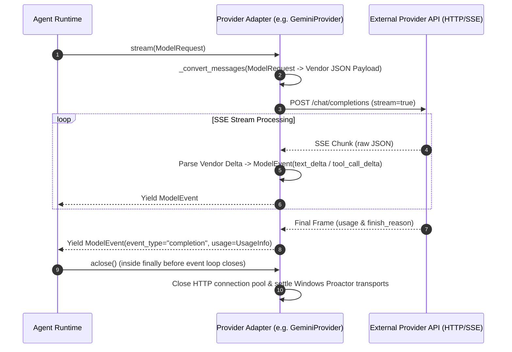
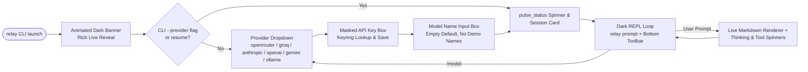
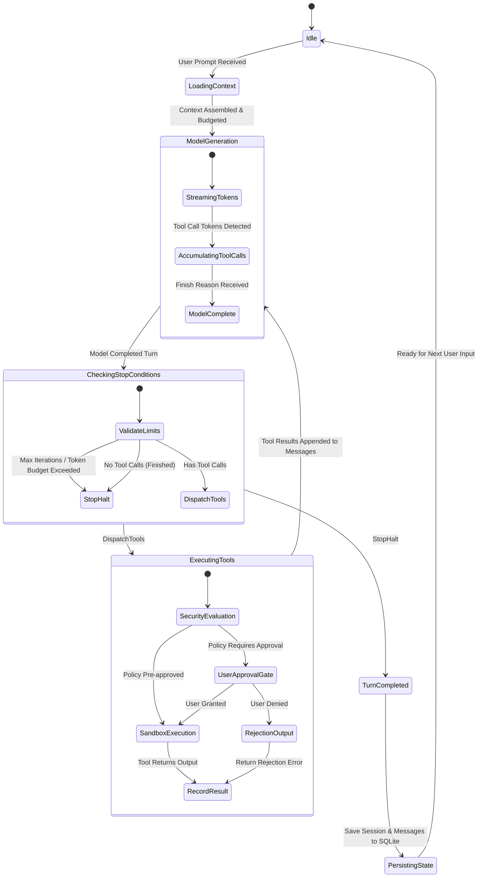
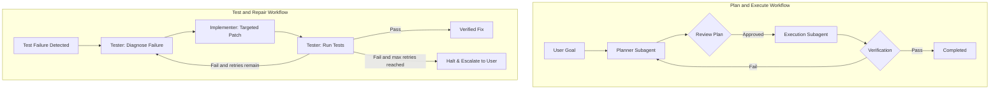
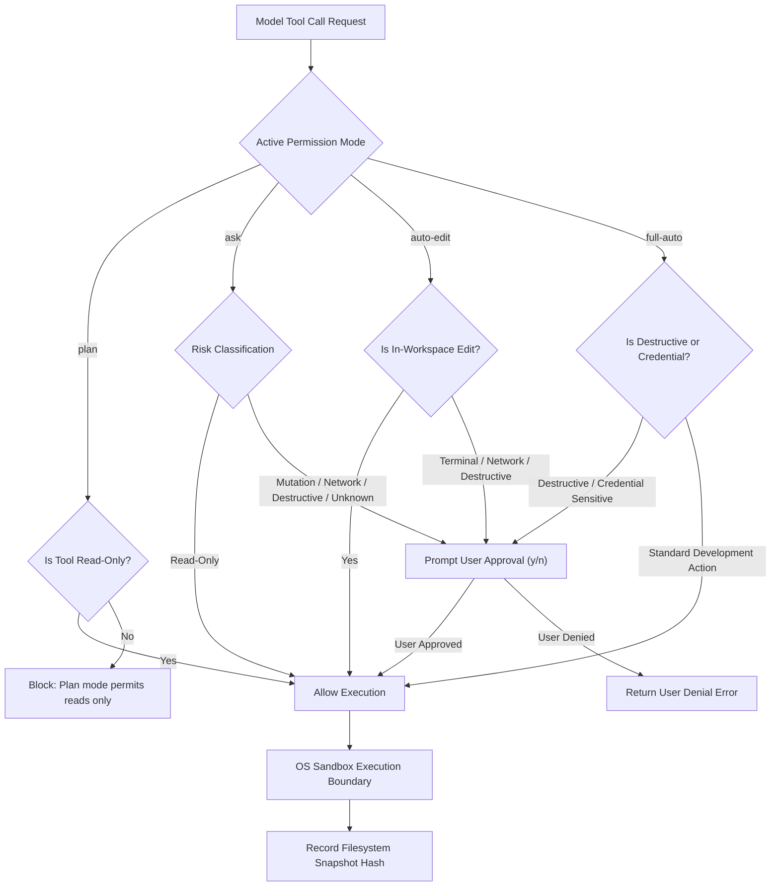
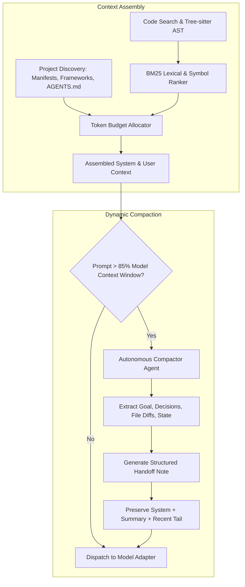
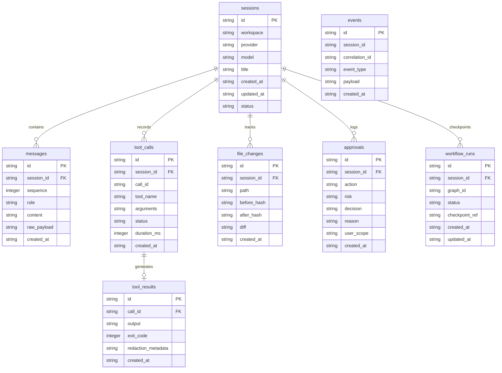
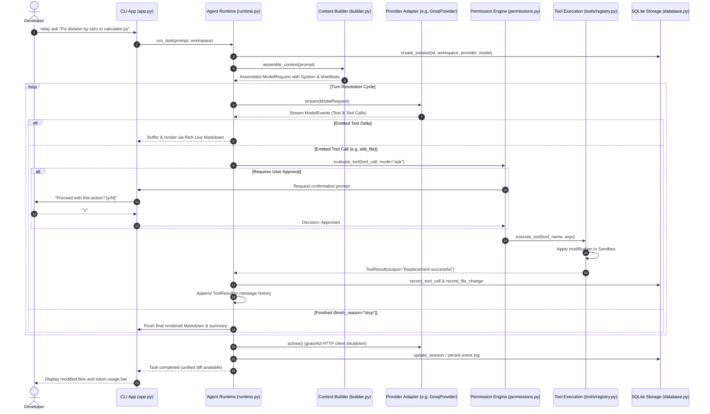

# Relay Architecture & System Design Specification

Relay is a provider-agnostic, local-first autonomous AI coding agent designed to operate inside a developer's terminal. It understands codebases, plans and executes multi-step engineering tasks, runs shell commands under strict security controls, diagnoses and repairs failing tests, and persists state across sessions.

This document describes the complete system architecture, package structure, data contracts, security model, context engine, workflow graphs, and runtime execution loops of Relay.

---

## 1. High-Level Architecture Overview

Relay is structured into decoupled, independently testable layers. The core runtime is strictly provider-neutral: changing from a cloud frontier model (e.g., Anthropic Claude 3.5 Sonnet or OpenAI GPT-4o) to a high-speed inference engine (Groq) or a fully local model (Ollama) requires no changes to tools, permissions, context management, or workflow logic.



---

## 2. Package & Layer Decomposition

The codebase is organized into dedicated functional modules under `Relay/`:

| Package / Module | Responsibility | Key Classes & Functions |
| :--- | :--- | :--- |
| **`Relay.agent`** | Custom autonomous agent runtime, streaming turn loop, message conversions, safety stops, and retry policies. | `AgentRuntime`, `AgentLoop`, `AgentState`, `StopConditions`, `RetryPolicy`, `ErrorClassifier` |
| **`Relay.cli`** | Developer CLI commands, interactive onboarding wizard (provider dropdown, masked API key box, model box), live streaming Markdown & spinner animations, and slash commands (`/model`, `/diff`, etc.). | `app`, `commands.py`, `display.py`, `prompts.py`, `pulse_status` |
| **`Relay.config`** | Configuration schemas, TOML loading, OS keyring secret storage, environment variable overrides. | `load_config`, `RootConfig`, `SecretManager` |
| **`Relay.context`** | Project discovery, AST parsing, BM25 symbol ranking, token budgeting, and transcript compaction. | `ProjectDiscovery`, `ContextBuilder`, `Compactor`, `IgnoreRules`, `CodeSearch` |
| **`Relay.integrations`** | Extensibility mechanisms: custom markdown skill discovery and lifecycle hook event dispatchers. | `SkillLoader`, `HookDispatcher`, `LifecycleEvent` |
| **`Relay.providers`** | Provider-agnostic adapter interfaces, message normalization, clean async teardown (`aclose`), capability registries, and vendor implementations. | `BaseProvider`, `LLMProvider`, `OpenAICompatibleProvider`, `CapabilityRegistry`, `ProviderRegistry`, `create_provider` |
| **`Relay.security`** | 4-tier permission modes, shell command risk classification, sandbox execution, approval prompts, and filesystem snapshots. | `PermissionManager`, `CommandPolicy`, `SandboxRunner`, `SnapshotManager`, `ApprovalHandler` |
| **`Relay.storage`** | Local SQLite persistence, WAL configuration, zero-dependency schema migration runner, and session/event stores. | `Database`, `SessionStore`, `EventStore`, `001_initial_schema.sql` |
| **`Relay.tools`** | Built-in file, terminal, git, search, diagnostics tools, tool registry, and MCP client integration. | `ToolRegistry`, `BaseTool`, `FileSystemTools`, `TerminalTool`, `MCPClient`, `PatchTool` |
| **`Relay.utils`** | Cross-platform utilities, unified exception hierarchy, secret-redacting logging (`WARNING` default for HTTP transports), and path sanitization. | `RelayError`, `get_platform_name`, `configure_logging`, `redact_secrets` |
| **`Relay.workflows`** | LangGraph orchestration graphs, specialist subagents (`Analyst`, `Implementer`, etc.), and checkpointing. | `GraphFactory`, `WorkflowState`, `WorkflowCheckpointer`, `SubagentFactory` |

---

## 3. Provider Abstraction & Model Interchangeability

Relay enforces strict normalization: no provider-specific SDK types, headers, or error objects leak into the agent runtime or tools.

### 3.1 Supported Providers Matrix

| Provider | Adapter Class | Transport / Base | Capabilities Supported | Authentication |
| :--- | :--- | :--- | :--- | :--- |
| **OpenRouter** | `OpenRouterProvider` | `OpenAICompatibleProvider` | Streaming, Tool Calling, Multi-provider Gateway | Bearer Token (`OPENROUTER_API_KEY`) |
| **Groq** | `GroqProvider` | `OpenAICompatibleProvider` | Ultra-fast Streaming, Parallel Tool Calling | Bearer Token (`GROQ_API_KEY`) |
| **Anthropic** | `AnthropicProvider` | Native `httpx` Messages API | Streaming, Tool Calling, System Prompt, Vision | Header `x-api-key` (`ANTHROPIC_API_KEY`) |
| **OpenAI** | `OpenAIProvider` | `OpenAICompatibleProvider` | Streaming, Parallel Tool Calls, Strict JSON | Bearer Token (`OPENAI_API_KEY`) |
| **Google Gemini** | `GeminiProvider` | `OpenAICompatibleProvider` (OpenAI-compat endpoint) | Streaming, Tool Calling, Large Context | Bearer / Key (`GEMINI_API_KEY`) |
| **Ollama** | `OllamaProvider` | Native `httpx` Local API | Local Streaming, Tool Calling, Offline Execution | None (Local `http://localhost:11434`) |

### 3.2 Universal Contract Data Model



### 3.3 Provider Request/Response & Clean Teardown Flow



### 3.4 Interactive Terminal UI & Session Lifecycle (`Relay/cli`)

Running `relay` in an interactive TTY executes an explicit onboarding and mid-session switching workflow built on `prompt_toolkit` and `Rich`:



---

## 4. Custom Agent Runtime & Turn Lifecycle

The agent runtime in `Relay/agent` executes an autonomous loop cycling between model inference and tool resolution until completion criteria are met.



### 4.1 Safety Stop Conditions & Resource Guards

The runtime enforces deterministic guardrails configured via `StopConditions`:
1. **Iteration Limit**: Caps execution at `max_iterations` (default: 30) to prevent infinite reasoning loops.
2. **Tool Call Limit**: Restricts cumulative tool calls per user turn (default: 50).
3. **Timeout Limit**: Wall-clock timeout (default: 300 seconds) terminating unresponsive operations.
4. **Token Budget Limit**: Monitors prompt and completion tokens against user-configured spend ceilings.
5. **Cancellation Signal**: `asyncio.Event` listener enabling immediate, safe abort upon user `Ctrl+C`.

### 4.2 Error Classification & Exponential Backoff

The `ErrorClassifier` maps runtime exceptions into actionable recovery policies:
- **Rate Limit (`429`) / Server Overload (`503`, `529`)**: Triggers `RetryPolicy` with exponential backoff and jitter (`base_delay=1.0s`, `backoff_factor=2.0`, `max_retries=3`).
- **Context Length Exceeded**: Immediately activates the `Compactor` to condense message history.
- **Tool Execution Errors**: Captured and returned to the model as `role="tool"` error messages, giving the agent opportunity to self-diagnose and correct parameters.
- **Authentication Failure (`401`, `403`)**: Non-retryable; immediately surfaces clear instructions to re-enter credentials (`relay provider add <name>`).

---

## 5. Advanced Workflows & LangGraph Integration

For multi-stage or high-complexity software engineering tasks, Relay pairs the custom runtime with structured **LangGraph** workflow graphs (`Relay/workflows`).

### 5.1 Specialist Subagents

Relay provides specialized subagents with strictly bounded tool permissions:

| Subagent | Role | Permitted Tools | Forbidden Actions |
| :--- | :--- | :--- | :--- |
| **Analyst** | Architecture analysis & call-tree inspection | `read_file`, `list_directory`, `search_code`, `find_files` | No file modifications, no shell execution |
| **Implementer**| Code changes & feature creation | `read_file`, `write_file`, `edit_file`, `apply_patch`, `search_code` | No destructive commands, no git push |
| **Tester** | Test authoring & execution | `read_file`, `write_file`, `run_tests`, `get_diagnostics` | No arbitrary terminal execution |
| **Reviewer** | Diff verification & vulnerability scan | `read_file`, `search_code`, `git_diff` | Read-only; cannot alter workspace files |

### 5.2 Workflow Graphs



### 5.3 Checkpointing & SQLite State Management

Every workflow node transition writes a checkpoint to the `workflow_runs` table:
- **Resumability**: Interrupted workflows can be resumed from the exact state of the last successful node.
- **Side-Effect Detection**: Prevents accidental re-execution of side-effecting operations (file edits or commands) when resuming a run.

---

## 6. Security Architecture & Sandbox Boundary

Security in Relay is governed by the `PermissionManager`, which evaluates every operation against workspace boundaries and command risk profiles.



### 6.1 Four-Tier Permission Modes

1. **`plan` (Inspection Only)**: Read-only operations allowed (`read_file`, `search_code`, `list_directory`, `git_status`). Any mutation attempt is immediately blocked.
2. **`ask` (Default)**: Safe inspection runs automatically; file modifications and terminal commands require user interactive confirmation.
3. **`auto-edit` (Autonomous Coding)**: Files within the workspace boundary can be edited or written without prompting; external access, package installation, network calls, and destructive operations still require confirmation.
4. **`full-auto` (Opt-in Unattended)**: Executes non-destructive coding and test workflows without prompt; highly destructive commands (`rm -rf`, disk writes, credential access) remain gated.

### 6.2 Command Risk Classification (`CommandPolicy`)

The `CommandPolicy` engine classifies shell commands using lexical parsing rather than simplistic substring matching:
- **Read-Only**: `ls`, `dir`, `cat`, `head`, `tail`, `grep`, `rg`, `git status`, `git diff`, `git log`.
- **Workspace Mutation**: `pytest`, `python -m pytest`, code formatters (`black`, `ruff`, `prettier`).
- **Network Operations**: `curl`, `wget`, `npm install`, `pip install`, `git fetch`.
- **Destructive**: `rm`, `del`, `format`, `dropdb`, `git reset --hard`, `git push --force`.
- **Privileged**: `sudo`, `chmod`, `chown`, `systemctl`, `reg`.

### 6.3 Platform-Native Sandbox Runners

| OS | Sandbox Isolation Mechanism | Default Boundaries |
| :--- | :--- | :--- |
| **Windows** | Isolated Subprocess + Process Trees + VirtualEnv PATH Injection | Restricted working directory, inheritance of virtualenv `Scripts`, termination of child process trees via `taskkill /F /T`. |
| **Linux** | Bubblewrap (`bwrap`) Namespaces | Unshared network namespace (`--unshare-net`), read-only root mounts, isolated `/tmp`, restricted writable workspace. |
| **macOS** | Seatbelt Sandbox Profiles (`sandbox-exec`) | Fine-grained Seatbelt profiles blocking unrequested file writes and outbound network sockets. |

---

## 7. Context Engineering & Compaction Engine

Relay avoids indiscriminate context dumping by combining on-demand discovery, BM25 symbol ranking, and autonomous transcript compaction.



### 7.1 Dynamic Token Budgeting

For any model, Relay dynamically calculates token allocations:
- **System Instructions & Tool Definitions**: Fixed baseline (~2,500 tokens).
- **Project Discovery & `AGENTS.md`**: Up to 10% of total window.
- **Retrieved Code Snippets**: Up to 30% of total window (ranked by relevance score).
- **Conversation Transcript**: Dynamically managed; triggers compaction at **85%** capacity.
- **Completion Output Reserve**: Preserves 15% of the model's max output limit for generation.

### 7.2 Structured Compaction Handoff

When compaction triggers, history is summarized into a standardized schema:
```markdown
<summary>
## Goal
[Original user request and acceptance criteria]

## What Happened
[Architectural decisions, hypotheses tested, failed approaches eliminated]

## Files Modified
[Full list of paths created, edited, or deleted]

## Current State
[Passing tests, broken components, current error diagnostics]

## Next Step
[Immediate next action required to complete the task]
</summary>
```

---

## 8. Tool Architecture & Model Context Protocol (MCP)

### 8.1 Built-in Tool Suite

Relay includes 12 first-party engineering tools:

| Category | Tool Name | Description | Key Security Check |
| :--- | :--- | :--- | :--- |
| **Filesystem** | `read_file` | Reads file content with optional start/end line bounds. | Path must reside within workspace. |
| | `write_file` | Writes full file content with automatic parent directory creation. | Path must reside within workspace; mode gate. |
| | `edit_file` | Performs exact string replacements within a file. | Single or unique match verification. |
| | `list_directory` | Lists directory entries with recursive depth filtering. | Path traversal blocked. |
| **Patch** | `apply_patch` | Applies unified git-style diffs cleanly to local files. | Rejects out-of-workspace diff headers. |
| **Search** | `search_code` | BM25 and regex search across codebase files. | Honors `.gitignore` and `.relayignore`. |
| | `find_files` | Glob pattern search for file names across the repository. | Honors ignore rules. |
| **Terminal** | `run_terminal_command` | Executes shell commands in the sandbox runner. | Evaluated by `CommandPolicy`. |
| **Testing** | `run_tests` | Automatically discovers and runs project test suites. | Virtualenv discovery and exit-code reporting. |
| | `get_diagnostics` | Inspects test failures, tracebacks, and lint warnings. | Read-only. |
| **Git** | `git_status` | Returns active working tree status and branch info. | Read-only. |
| | `git_diff` | Computes unified git diffs against HEAD or index. | Read-only. |

### 8.2 Model Context Protocol (MCP) Client Integration

Relay acts as an MCP host via `Relay/tools/mcp`:
- **Stdio Transport**: Connects to external MCP servers running as child processes.
- **Dynamic Namespacing**: Discovered tools are namespaced (`mcp__<server_name>__<tool_name>`) to avoid collisions with built-in tools.
- **Unified Security Gating**: MCP tools are subject to the same `PermissionManager` policies as built-in tools.

---

## 9. Persistence & Storage Architecture

Relay uses a local, zero-dependency SQLite database stored in `.relay/relay.db` (or user cache dir).

### 9.1 Entity-Relationship Model



---

## 10. End-to-End Interaction Trace



---

## 11. Architectural Decision Matrix

| Decision Area | Selected Approach | Alternatives Considered | Rational Architecture Trade-off |
| :--- | :--- | :--- | :--- |
| **Agent Runtime** | Custom Python Async Turn Loop | Heavy agent frameworks (CrewAI, AutoGen) | Total transparency over message serialization, zero unwanted abstractions, direct control over stop conditions and streaming. |
| **Workflow Engine**| LangGraph | Custom DAG runner | Standardized checkpointing, cyclic multi-agent graph flows, and robust state serialization. |
| **Persistence** | SQLite with WAL Mode | Flat JSONL files / Postgres | ACID compliance, zero external server dependencies, immediate indexed query performance, foreign key integrity. |
| **Secret Storage** | OS Keyring (`keyring` lib) | Plaintext `.env` files | High security standard across Windows Credential Locker, macOS Keychain, and Linux SecretService. |
| **Context Retrieval**| Tree-sitter AST + BM25 | External Vector DB (Chroma, Pinecone) | Lightweight, instantaneous startup, zero API embedding costs, exact symbol matches for codebases. |
| **Tool Execution** | In-process Registry + OS Sandbox | Container-only (Docker) | Instant execution without Docker overhead, while providing container modes when explicitly requested. |

---

## 12. Cross-Platform Boundary Matrix

| Capability | Windows (Win32) | macOS (Darwin) | Linux (GNU/Linux) |
| :--- | :--- | :--- | :--- |
| **Shell Runner** | PowerShell / `cmd.exe` / Git Bash | `/bin/zsh` or `/bin/bash` | `/bin/bash` or `/bin/sh` |
| **Process Tree Cleanup** | `taskkill /F /T /PID` | `os.killpg(pgid, SIGKILL)` | `os.killpg(pgid, SIGKILL)` |
| **Sandbox Isolation** | VirtualEnv PATH + Subprocess Quotas | Seatbelt (`sandbox-exec`) | Bubblewrap (`bwrap`) Namespaces |
| **Secure Keyring** | Windows Credential Manager | macOS Keychain | SecretService / DBus Keyring |
| **Path Handling** | Windows Long Paths (`\\?\`) & Normalized forward slashes | POSIX standard | POSIX standard |
